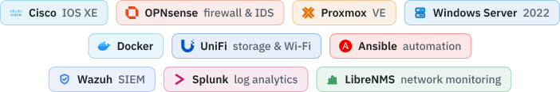
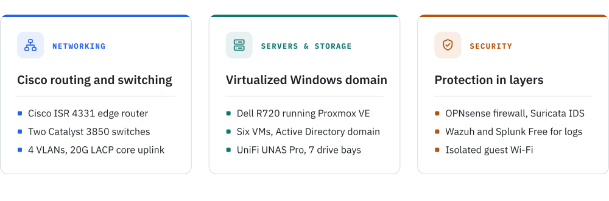
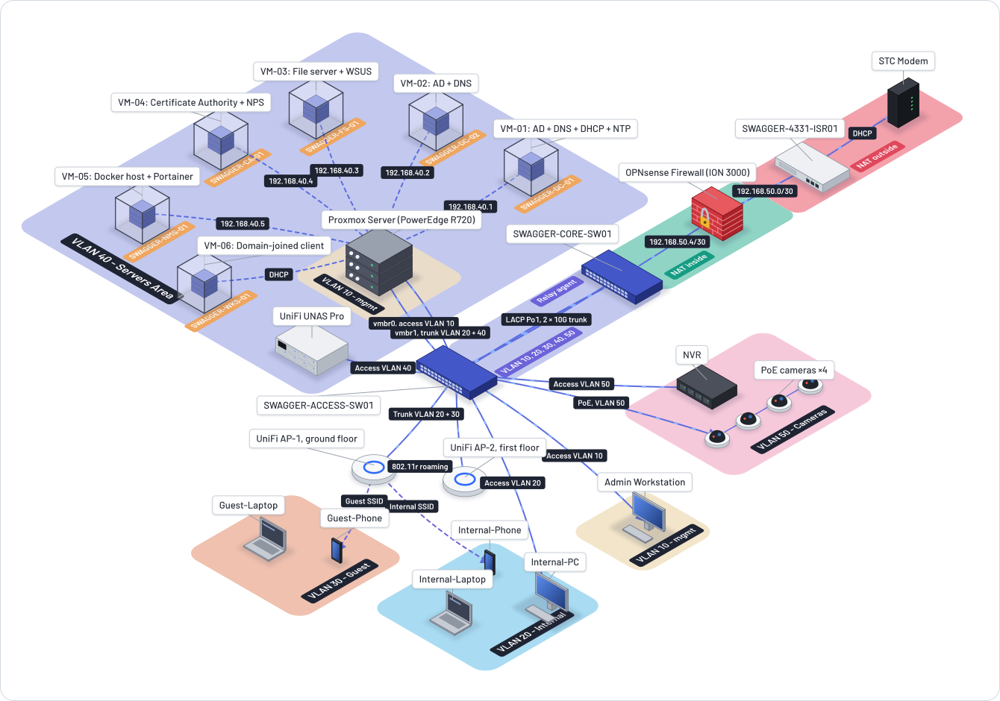
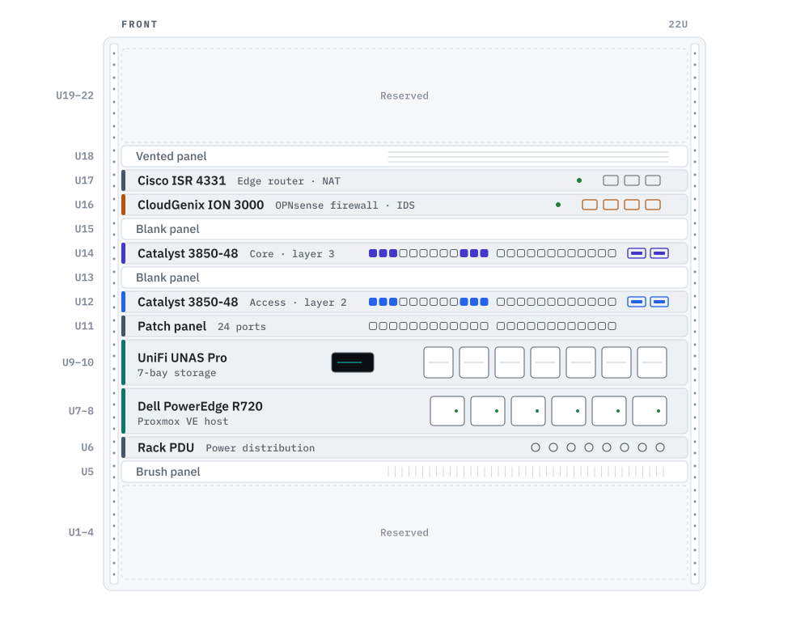
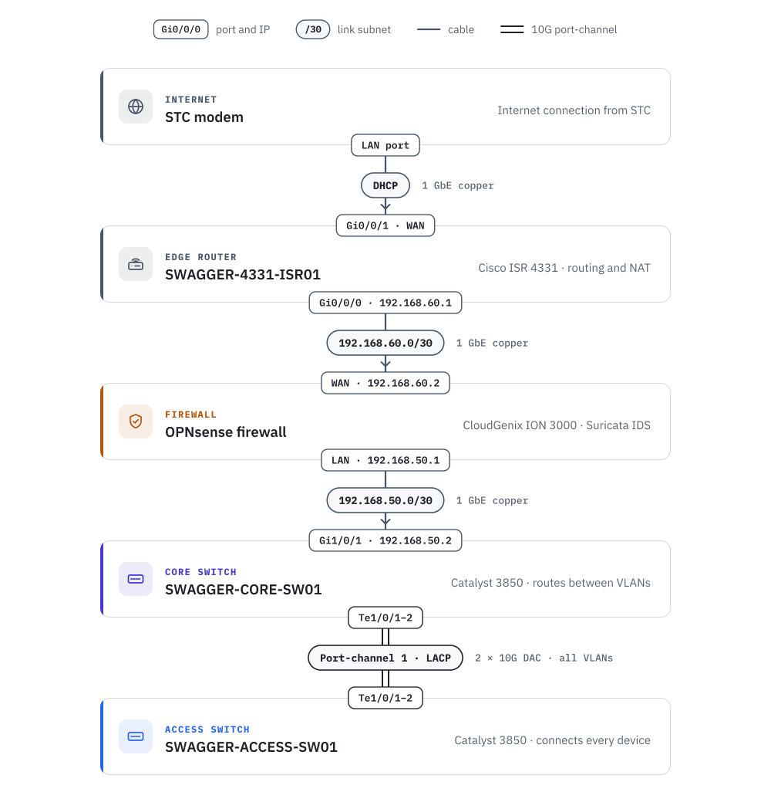
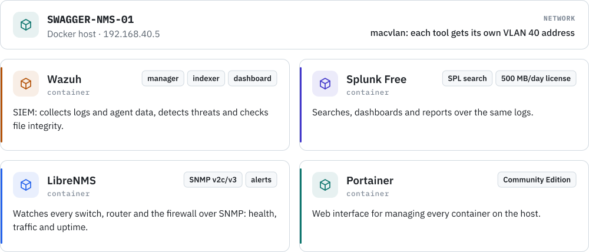

<picture>
  <source media="(prefers-color-scheme: dark)" srcset="assets/banner.svg">
  <source media="(prefers-color-scheme: light)" srcset="assets/banner-light.svg">
  
</picture>

 

<picture>
  <source media="(prefers-color-scheme: dark)" srcset="assets/label-built-dark.svg">
  <source media="(prefers-color-scheme: light)" srcset="assets/label-built-light.svg">
  
</picture>

<picture>
  <source media="(prefers-color-scheme: dark)" srcset="assets/stack-dark.svg">
  <source media="(prefers-color-scheme: light)" srcset="assets/stack-light.svg">
  
</picture>

 

<picture>
  <source media="(prefers-color-scheme: dark)" srcset="assets/label-jump-dark.svg">
  <source media="(prefers-color-scheme: light)" srcset="assets/label-jump-light.svg">
  
</picture>

<a href="#overview"><picture><source media="(prefers-color-scheme: dark)" srcset="assets/nav-overview-dark.svg"><source media="(prefers-color-scheme: light)" srcset="assets/nav-overview-light.svg"></picture></a>&nbsp;
<a href="#topology"><picture><source media="(prefers-color-scheme: dark)" srcset="assets/nav-topology-dark.svg"><source media="(prefers-color-scheme: light)" srcset="assets/nav-topology-light.svg"></picture></a>&nbsp;
<a href="#walkthrough"><picture><source media="(prefers-color-scheme: dark)" srcset="assets/nav-walkthrough-dark.svg"><source media="(prefers-color-scheme: light)" srcset="assets/nav-walkthrough-light.svg"></picture></a>&nbsp;
<a href="#design-decisions"><picture><source media="(prefers-color-scheme: dark)" srcset="assets/nav-design-dark.svg"><source media="(prefers-color-scheme: light)" srcset="assets/nav-design-light.svg"></picture></a>&nbsp;
<a href="#hardware"><picture><source media="(prefers-color-scheme: dark)" srcset="assets/nav-hardware-dark.svg"><source media="(prefers-color-scheme: light)" srcset="assets/nav-hardware-light.svg"></picture></a>&nbsp;
 
<a href="#rack-elevation"><picture><source media="(prefers-color-scheme: dark)" srcset="assets/nav-rack-dark.svg"><source media="(prefers-color-scheme: light)" srcset="assets/nav-rack-light.svg"></picture></a>&nbsp;
<a href="#network"><picture><source media="(prefers-color-scheme: dark)" srcset="assets/nav-network-dark.svg"><source media="(prefers-color-scheme: light)" srcset="assets/nav-network-light.svg"></picture></a>&nbsp;
<a href="#servers"><picture><source media="(prefers-color-scheme: dark)" srcset="assets/nav-servers-dark.svg"><source media="(prefers-color-scheme: light)" srcset="assets/nav-servers-light.svg"></picture></a>&nbsp;
<a href="#domain-and-email"><picture><source media="(prefers-color-scheme: dark)" srcset="assets/nav-domain-dark.svg"><source media="(prefers-color-scheme: light)" srcset="assets/nav-domain-light.svg"></picture></a>&nbsp;
<a href="#security-design"><picture><source media="(prefers-color-scheme: dark)" srcset="assets/nav-security-dark.svg"><source media="(prefers-color-scheme: light)" srcset="assets/nav-security-light.svg"></picture></a>&nbsp;

 

## <picture><source media="(prefers-color-scheme: dark)" srcset="assets/h-overview-dark.svg"><source media="(prefers-color-scheme: light)" srcset="assets/h-overview-light.svg"></picture>Overview

A home data center I designed, built and secured in a 22U rack. It runs the same building blocks a business network depends on: Cisco routing and switching, a dedicated firewall, a virtualized Windows Server domain, central storage and security monitoring.

<picture>
  <source media="(prefers-color-scheme: dark)" srcset="assets/overview-dark.svg">
  <source media="(prefers-color-scheme: light)" srcset="assets/overview-light.svg">
  
</picture>

> [!TIP]
> **New here?** Start with the **Topology** diagram and the **Walkthrough** video for the big picture. **Design decisions** explains why it's built this way. The sections after it hold the details: hardware, network, servers and security.

 

## <picture><source media="(prefers-color-scheme: dark)" srcset="assets/h-lab-dark.svg"><source media="(prefers-color-scheme: light)" srcset="assets/h-lab-light.svg"></picture>Lab in numbers

The lab at a glance.

 

 

## <picture><source media="(prefers-color-scheme: dark)" srcset="assets/h-topology-dark.svg"><source media="(prefers-color-scheme: light)" srcset="assets/h-topology-light.svg"></picture>Topology

How everything connects, from the internet link down to each VLAN.

  

> [!NOTE]
> **Reading the diagram:** traffic from the internet comes in through the STC modem and the ISR 4331, passes through OPNsense to be filtered and inspected, then reaches the core switch, which routes it to the right VLAN. The access switch connects every device, and each colored zone is one VLAN.

 

## <picture><source media="(prefers-color-scheme: dark)" srcset="assets/h-walkthrough-dark.svg"><source media="(prefers-color-scheme: light)" srcset="assets/h-walkthrough-light.svg"></picture>Walkthrough

A guided tour of the topology, from the edge router down to every VLAN and virtual machine.

https://github.com/user-attachments/assets/00f0f240-d347-4e98-bb69-2ba5701e0d6b

 

## <picture><source media="(prefers-color-scheme: dark)" srcset="assets/h-design-dark.svg"><source media="(prefers-color-scheme: light)" srcset="assets/h-design-light.svg"></picture>Design decisions

Why the network is built the way it is.

<picture>
  <source media="(prefers-color-scheme: dark)" srcset="assets/design-decisions-dark.svg">
  <source media="(prefers-color-scheme: light)" srcset="assets/design-decisions-light.svg">
  
</picture>

 

## <picture><source media="(prefers-color-scheme: dark)" srcset="assets/h-hardware-dark.svg"><source media="(prefers-color-scheme: light)" srcset="assets/h-hardware-light.svg"></picture>Hardware

What's in the rack and what each device does. The chip in each corner is the device's position in the rack.

<picture>
  <source media="(prefers-color-scheme: dark)" srcset="assets/hardware-dark.svg">
  <source media="(prefers-color-scheme: light)" srcset="assets/hardware-light.svg">
  
</picture>

 

## <picture><source media="(prefers-color-scheme: dark)" srcset="assets/h-rack-dark.svg"><source media="(prefers-color-scheme: light)" srcset="assets/h-rack-light.svg"></picture>Rack elevation

The 22U rack, front view, from top to bottom. The colored edge on each device matches its layer above.

<picture>
  <source media="(prefers-color-scheme: dark)" srcset="assets/rack-dark.svg">
  <source media="(prefers-color-scheme: light)" srcset="assets/rack-light.svg">
  
</picture>

 

## <picture><source media="(prefers-color-scheme: dark)" srcset="assets/h-network-dark.svg"><source media="(prefers-color-scheme: light)" srcset="assets/h-network-light.svg"></picture>Network

Five VLANs split the network by role, plus a native VLAN that carries no hosts. Each card shows the subnet, the gateway and how devices on it get their addresses.

<picture>
  <source media="(prefers-color-scheme: dark)" srcset="assets/vlans-dark.svg">
  <source media="(prefers-color-scheme: light)" srcset="assets/vlans-light.svg">
  
</picture>

 

## <picture><source media="(prefers-color-scheme: dark)" srcset="assets/h-backbone-dark.svg"><source media="(prefers-color-scheme: light)" srcset="assets/h-backbone-light.svg"></picture>Backbone links

How traffic gets from the internet to the access switch. Each card is a device and each line is a cable. Where a cable meets a card, the tag shows that device's port and IP; the label on the cable is the link's subnet.

<picture>
  <source media="(prefers-color-scheme: dark)" srcset="assets/backbone-dark.svg">
  <source media="(prefers-color-scheme: light)" srcset="assets/backbone-light.svg">
  
</picture>

 

## <picture><source media="(prefers-color-scheme: dark)" srcset="assets/h-ports-dark.svg"><source media="(prefers-color-scheme: light)" srcset="assets/h-ports-light.svg"></picture>Access switch ports

Every device plugs into the access switch. Access ports carry one VLAN; trunk ports carry several.

<picture>
  <source media="(prefers-color-scheme: dark)" srcset="assets/switch-ports-dark.svg">
  <source media="(prefers-color-scheme: light)" srcset="assets/switch-ports-light.svg">
  
</picture>

How it's cabled: each patch panel port feeds the switch port with the same number. Cord colors follow the VLANs, and trunk cords are striped with the VLANs they carry.

<picture>
  <source media="(prefers-color-scheme: dark)" srcset="assets/cabling-dark.svg">
  <source media="(prefers-color-scheme: light)" srcset="assets/cabling-light.svg">
  
</picture>

> [!NOTE]
> **Good to know:** every gateway is the last usable address in its subnet (`.254`) and lives on the core switch. Trunks carry only the VLANs they need: VLANs 20 and 40 to Proxmox, and VLANs 20 and 30 to each access point. The access points take their own management address untagged, on native VLAN 10.

 

## <picture><source media="(prefers-color-scheme: dark)" srcset="assets/h-servers-dark.svg"><source media="(prefers-color-scheme: light)" srcset="assets/h-servers-light.svg"></picture>Servers

Six virtual machines run on Proxmox: four Windows Server 2022 servers, a Windows 11 client and a Linux Docker host. The Windows machines form the `swagger.rayanaldossary.com` Active Directory domain.

<picture>
  <source media="(prefers-color-scheme: dark)" srcset="assets/servers-dark.svg">
  <source media="(prefers-color-scheme: light)" srcset="assets/servers-light.svg">
  
</picture>

> [!NOTE]
> **SWAGGER-WKS-01 is a VM, not a physical PC.** It runs on the same Proxmox host as the servers, but its network card sits on the VLAN 20 side of the trunk, so it behaves like any other Internal client and gets its address by DHCP from SWAGGER-DC-01.

 

## <picture><source media="(prefers-color-scheme: dark)" srcset="assets/h-containers-dark.svg"><source media="(prefers-color-scheme: light)" srcset="assets/h-containers-light.svg"></picture>Containers on SWAGGER-NMS-01

The monitoring and security tools run as Docker containers on SWAGGER-NMS-01.

<picture>
  <source media="(prefers-color-scheme: dark)" srcset="assets/containers-dark.svg">
  <source media="(prefers-color-scheme: light)" srcset="assets/containers-light.svg">
  
</picture>

 

## <picture><source media="(prefers-color-scheme: dark)" srcset="assets/h-domain-dark.svg"><source media="(prefers-color-scheme: light)" srcset="assets/h-domain-light.svg"></picture>Domain and email

The lab runs under my own domain, `rayanaldossary.com`. Its public DNS and email live on Cloudflare and Google Workspace. Active Directory uses a subdomain of it, `swagger.rayanaldossary.com`, which only resolves inside the lab.

<picture>
  <source media="(prefers-color-scheme: dark)" srcset="assets/domain-dark.svg">
  <source media="(prefers-color-scheme: light)" srcset="assets/domain-light.svg">
  
</picture>

> [!NOTE]
> **Why a subdomain?** Microsoft recommends naming an Active Directory domain after a subdomain of a domain you own, instead of an invented suffix like `.local` or `.lab`. That way, internal names can never clash with anyone else's on the internet.

 

## <picture><source media="(prefers-color-scheme: dark)" srcset="assets/h-security-dark.svg"><source media="(prefers-color-scheme: light)" srcset="assets/h-security-light.svg"></picture>Security design

How the lab is protected, layer by layer. The zones run from least trusted on the left to most trusted on the right.

<picture>
  <source media="(prefers-color-scheme: dark)" srcset="assets/trust-zones-dark.svg">
  <source media="(prefers-color-scheme: light)" srcset="assets/trust-zones-light.svg">
  
</picture>

Zone 4 isn't a separate cable path. It's a privilege boundary enforced by an access list on every network device.

<picture>
  <source media="(prefers-color-scheme: dark)" srcset="assets/security-controls-dark.svg">
  <source media="(prefers-color-scheme: light)" srcset="assets/security-controls-light.svg">
  
</picture>

 

## <picture><source media="(prefers-color-scheme: dark)" srcset="assets/h-pipeline-dark.svg"><source media="(prefers-color-scheme: light)" srcset="assets/h-pipeline-light.svg"></picture>Detection pipeline

The lab's devices send their logs to Wazuh, which runs in Docker on SWAGGER-NMS-01. The animation follows one attack from start to finish: a brute-force login attempt on SWAGGER-DC-01 raises a level 10 alert, Wazuh blocks the source, and the alert is forwarded to Splunk.

<picture>
  <source media="(prefers-color-scheme: dark)" srcset="assets/pipeline-dark.svg">
  <source media="(prefers-color-scheme: light)" srcset="assets/pipeline-light.svg">
  
</picture>

 

Built and documented by <a href="https://github.com/Rayan-Aldossary">Rayan Aldossary</a>

