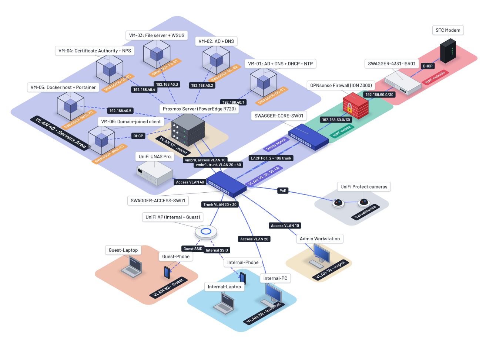
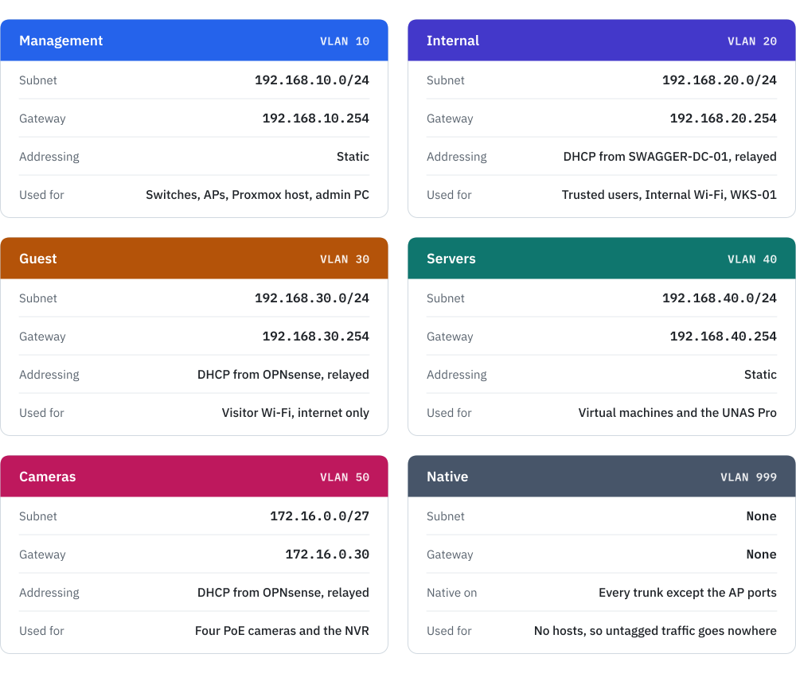
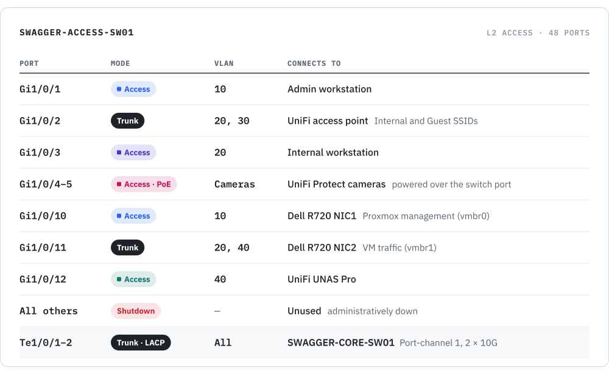
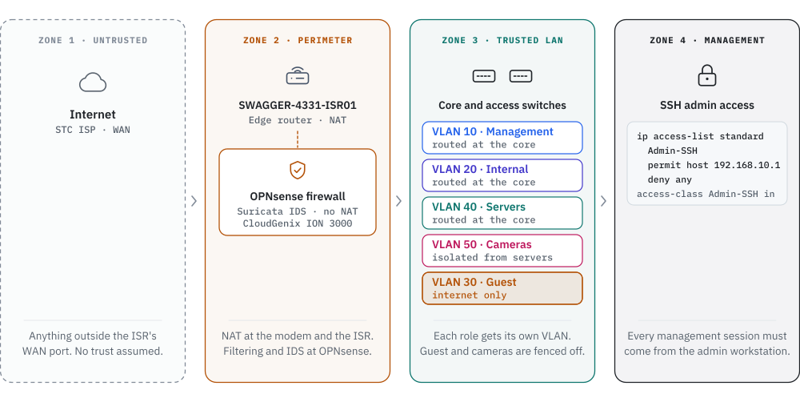

<picture>
  <source media="(prefers-color-scheme: dark)" srcset="banner.svg">
  <source media="(prefers-color-scheme: light)" srcset="banner-light.svg">
  
</picture>

  &nbsp;
  &nbsp;
  &nbsp;
  &nbsp;
   
  &nbsp;
  &nbsp;
  &nbsp;
  &nbsp;

  <a href="#overview"><b>Overview</b></a> ·
  <a href="#topology"><b>Topology</b></a> ·
  <a href="#walkthrough"><b>Walkthrough</b></a> ·
  <a href="#design-decisions"><b>Design</b></a> ·
  <a href="#hardware"><b>Hardware</b></a> ·
  <a href="#network"><b>Network</b></a> ·
  <a href="#servers"><b>Servers</b></a> ·
  <a href="#security-design"><b>Security</b></a>

## Overview

A home data center I designed, built and secured in a 22U rack. It runs the same building blocks a business network depends on: Cisco routing and switching, a dedicated firewall, a virtualized Windows Server domain, central storage and security monitoring.

<picture>
  <source media="(prefers-color-scheme: dark)" srcset="assets/overview-dark.svg">
  <source media="(prefers-color-scheme: light)" srcset="assets/overview-light.svg">
  
</picture>

> [!TIP]
> **New here?** Start with the **Topology** diagram and the **Walkthrough** video for the big picture. **Design decisions** explains why it's built this way. The sections after it hold the details: hardware, network, servers and security.

## Lab in numbers

The lab at a glance.

## Topology

How everything connects, from the internet link down to each VLAN.

  

> [!NOTE]
> **Reading the diagram:** traffic from the internet comes in through the STC modem and the ISR 4331, passes through OPNsense to be filtered and inspected, then reaches the core switch, which routes it to the right VLAN. The access switch connects every device, and each colored zone is one VLAN.

## Walkthrough

A guided tour of the topology, from the edge router down to every VLAN and virtual machine.

https://github.com/user-attachments/assets/00f0f240-d347-4e98-bb69-2ba5701e0d6b

## Design decisions

Why the network is built the way it is.

<picture>
  <source media="(prefers-color-scheme: dark)" srcset="assets/design-decisions-dark.svg">
  <source media="(prefers-color-scheme: light)" srcset="assets/design-decisions-light.svg">
  
</picture>

## Hardware

What's in the rack and what each device does. The chip in each corner is the device's position in the rack.

<picture>
  <source media="(prefers-color-scheme: dark)" srcset="assets/hardware-dark.svg">
  <source media="(prefers-color-scheme: light)" srcset="assets/hardware-light.svg">
  
</picture>

### Rack elevation

The 22U rack, front view, from top to bottom. The colored edge on each device matches its layer above.

<picture>
  <source media="(prefers-color-scheme: dark)" srcset="assets/rack-dark.svg">
  <source media="(prefers-color-scheme: light)" srcset="assets/rack-light.svg">
  
</picture>

## Network

Four VLANs split the network by role. Each card shows the subnet, the gateway and how devices on it get their addresses.

<picture>
  <source media="(prefers-color-scheme: dark)" srcset="assets/vlans-dark.svg">
  <source media="(prefers-color-scheme: light)" srcset="assets/vlans-light.svg">
  
</picture>

### Backbone links

The chain from the internet to the access switch. Each routed hop is its own /30 point-to-point subnet, and the two switches are joined by a 2 × 10G port-channel.

<picture>
  <source media="(prefers-color-scheme: dark)" srcset="assets/backbone-dark.svg">
  <source media="(prefers-color-scheme: light)" srcset="assets/backbone-light.svg">
  
</picture>

### Access switch ports

Every device plugs into the access switch. Access ports carry one VLAN; trunk ports carry several.

<picture>
  <source media="(prefers-color-scheme: dark)" srcset="assets/switch-ports-dark.svg">
  <source media="(prefers-color-scheme: light)" srcset="assets/switch-ports-light.svg">
  
</picture>

> [!NOTE]
> **Good to know:** every gateway is the last usable address in its subnet (`.254`) and lives on the core switch. Trunks carry only the VLANs they need: VLANs 20 and 40 to Proxmox, VLANs 20 and 30 to the access point.

## Servers

Six virtual machines run on Proxmox: four Windows Server 2022 servers, a Windows 11 client and a Linux Docker host. The Windows machines form the `swagger.lab` Active Directory domain.

<picture>
  <source media="(prefers-color-scheme: dark)" srcset="assets/servers-dark.svg">
  <source media="(prefers-color-scheme: light)" srcset="assets/servers-light.svg">
  
</picture>

> [!NOTE]
> **SWAGGER-WKS-01 is a VM, not a physical PC.** It runs on the same Proxmox host as the servers, but its network card sits on the VLAN 20 side of the trunk, so it behaves like any other Internal client and gets its address by DHCP from SWAGGER-DC-01.

### Containers on SWAGGER-NMS-01

The monitoring and security tools run as Docker containers on SWAGGER-NMS-01.

<picture>
  <source media="(prefers-color-scheme: dark)" srcset="assets/containers-dark.svg">
  <source media="(prefers-color-scheme: light)" srcset="assets/containers-light.svg">
  
</picture>

## Security design

How the lab is protected, layer by layer. The zones run from least trusted on the left to most trusted on the right.

<picture>
  <source media="(prefers-color-scheme: dark)" srcset="assets/trust-zones-dark.svg">
  <source media="(prefers-color-scheme: light)" srcset="assets/trust-zones-light.svg">
  
</picture>

Zone 4 isn't a separate cable path. It's a privilege boundary enforced by an access list on every network device.

<picture>
  <source media="(prefers-color-scheme: dark)" srcset="assets/security-controls-dark.svg">
  <source media="(prefers-color-scheme: light)" srcset="assets/security-controls-light.svg">
  
</picture>

 

Built and documented by <a href="https://github.com/Rayan-Aldossary">Rayan Aldossary</a>

