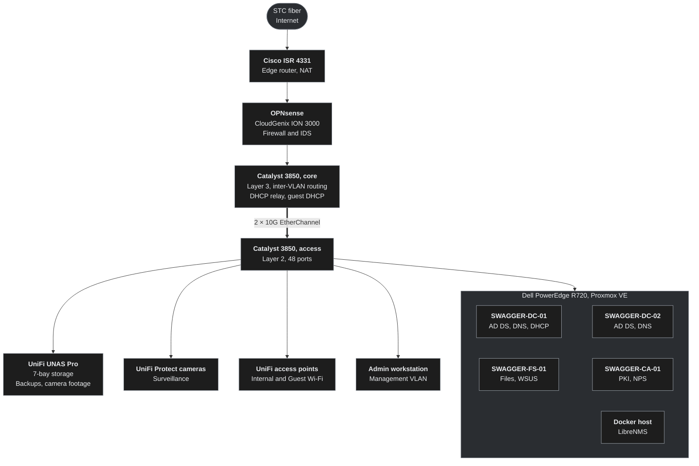

  

  
  
  
  
  
  
   
  
  

A small company network, built at home on the same hardware businesses run: Cisco routing and switching, an OPNsense firewall, a Proxmox virtualization host, a Windows Server domain, UniFi storage and surveillance, and a monitoring stack.

## Topology

The ISR 4331 handles the internet connection and NAT. OPNsense sits behind it as the firewall and IDS without a second layer of NAT, and the core switch routes between VLANs.

## Hardware

| Device | Role |
|---|---|
| Cisco ISR 4331 | Edge router, NAT, WAN |
| CloudGenix ION 3000 | OPNsense firewall and IDS between the edge router and the core |
| Cisco Catalyst 3850-48 | Core switch: layer 3, inter-VLAN routing, DHCP relay |
| Cisco Catalyst 3850-48 | Access switch: layer 2, 2 × 10G EtherChannel to the core |
| Dell PowerEdge R720 | Proxmox VE host, 384 GB RAM |
| UniFi UNAS Pro | 7-bay storage for backups, files and camera footage |
| UniFi Protect cameras | Surveillance |
| UniFi access points | Internal and Guest Wi-Fi |
| UniFi UPS and rack PDU | Power |

<b>Rack elevation (22U)</b>

| U | Device |
|---|---|
| 19–22 | Reserved |
| 18 | Vented panel |
| 17 | Cisco ISR 4331 |
| 16 | CloudGenix ION 3000 (OPNsense) |
| 15 | Blank panel |
| 14 | Catalyst 3850, core |
| 13 | Blank panel |
| 12 | Catalyst 3850, access |
| 11 | 24-port patch panel |
| 9–10 | UniFi UNAS Pro |
| 7–8 | Dell PowerEdge R720 |
| 6 | PDU |
| 5 | Brush panel |
| 1–4 | Reserved |

## Network

| VLAN | Name | Subnet | Gateway | Addressing |
|---|---|---|---|---|
| 10 | Management | 192.168.10.0/24 | 192.168.10.254 | Static |
| 20 | Internal | 192.168.20.0/24 | 192.168.20.254 | DHCP from SWAGGER-DC-01, relayed by the core |
| 30 | Guest | 192.168.30.0/24 | 192.168.30.254 | DHCP from the core switch |
| 40 | Servers | 192.168.40.0/24 | 192.168.40.254 | Static |
| 999 | Native | None | None | No hosts |

Gateways are the last usable address in each subnet and live on the core switch. The Proxmox host uses two links: one access port in the Management VLAN for the host itself, and one trunk carrying VLANs 20 and 40 for the virtual machines.

## Servers

Active Directory domain: `swagger.lab`

| Host | Services | Address |
|---|---|---|
| SWAGGER-DC-01 | AD DS, DNS, DHCP, NTP | 192.168.40.1 |
| SWAGGER-DC-02 | Second domain controller: AD DS, DNS | 192.168.40.2 |
| SWAGGER-FS-01 | File server, WSUS | 192.168.40.3 |
| SWAGGER-CA-01 | Certificate authority, NPS (RADIUS) | 192.168.40.4 |
| SWAGGER-WKS-01 | Windows 11 domain client | DHCP, VLAN 20 |
| Docker host | LibreNMS and security monitoring | VLAN 40 |

## Security design

- **Segmentation.** Management, users, guests and servers each get their own VLAN. The native VLAN carries no hosts.
- **Firewall and IDS.** OPNsense filters and inspects traffic between the edge router and the core.
- **Guest isolation.** The Guest VLAN gets internet access only, with its own DHCP on the core switch.
- **No inbound exposure.** No port forwards, no VPN and no public services.
- **Identity.** Active Directory with two domain controllers, plus a certificate authority and NPS for RADIUS.
- **Patching.** WSUS manages Windows updates across the domain.
- **Monitoring.** LibreNMS watches every device over SNMP, alongside security monitoring tools on Docker.
- **Surveillance.** UniFi Protect cameras, with footage kept on the UNAS Pro.
- **Backups.** Servers and files back up to the UNAS Pro, separate from the R720's own drives.
- **Safe publishing.** Configs are sanitized before they're committed. No passwords or secrets live in this repo.

---

Built and documented by <a href="https://github.com/Rayan-Aldossary">Rayan Aldossary</a>, CCNA

