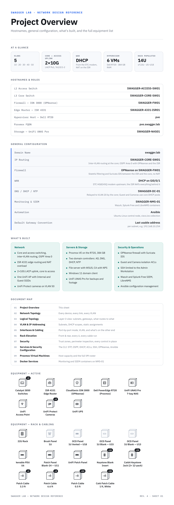
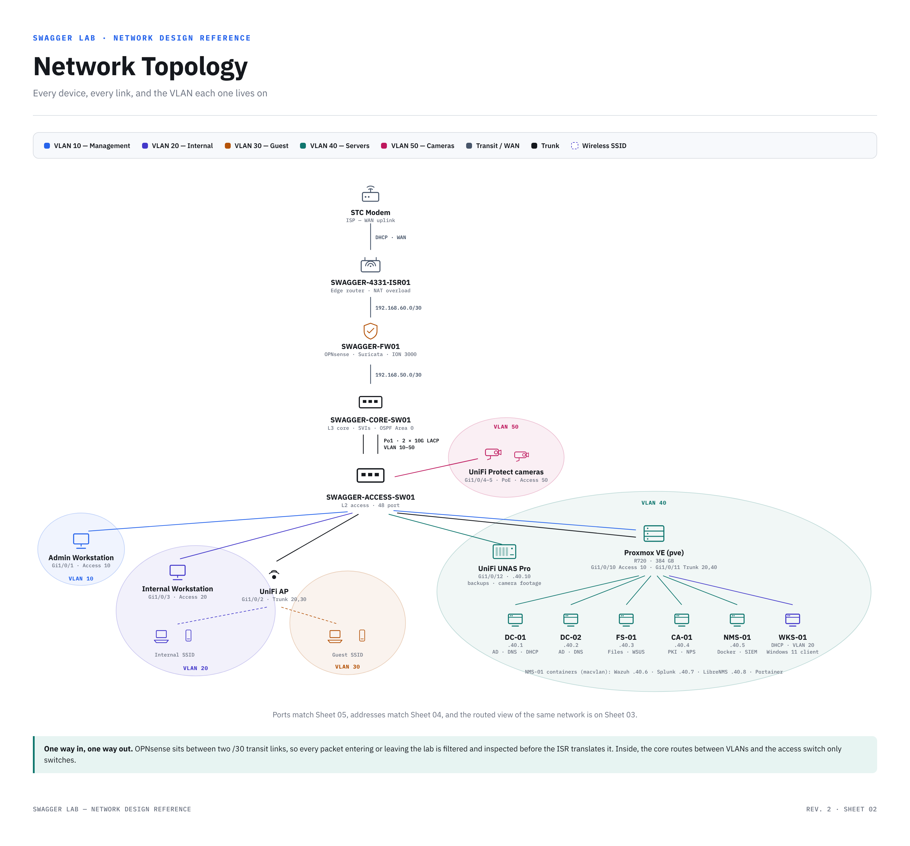
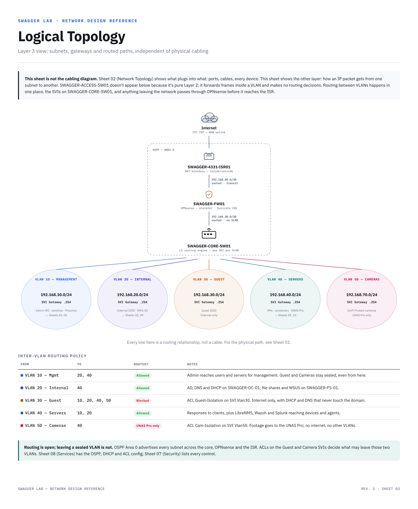
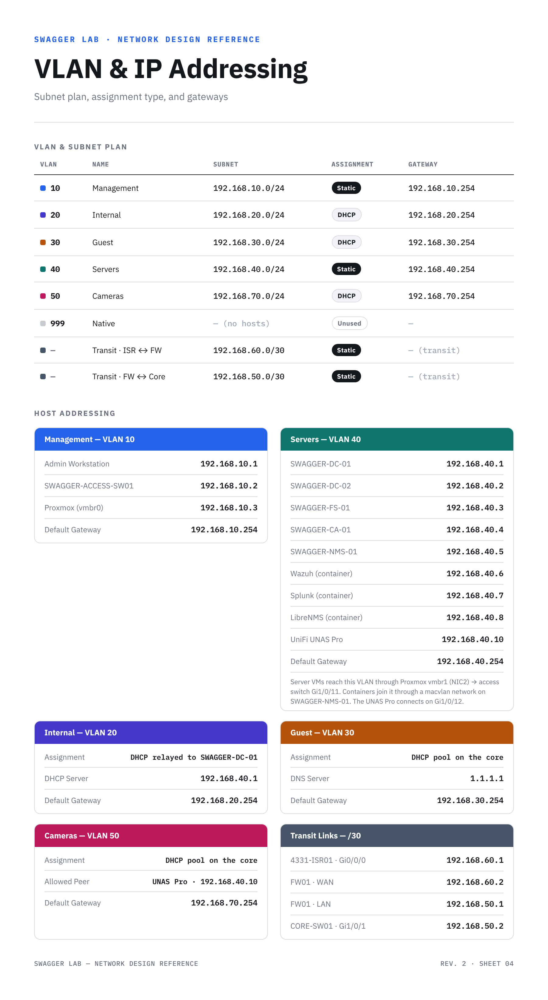
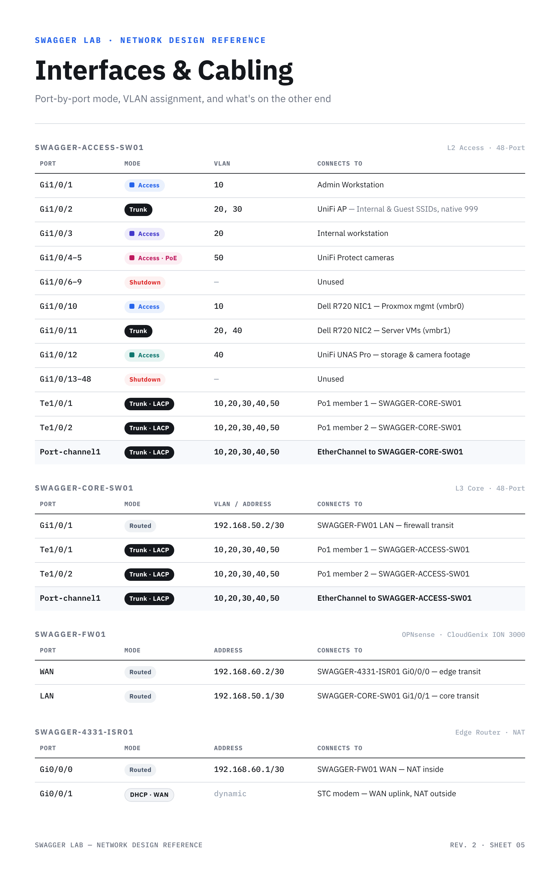
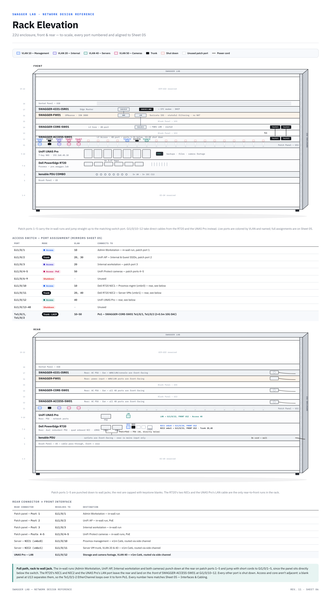
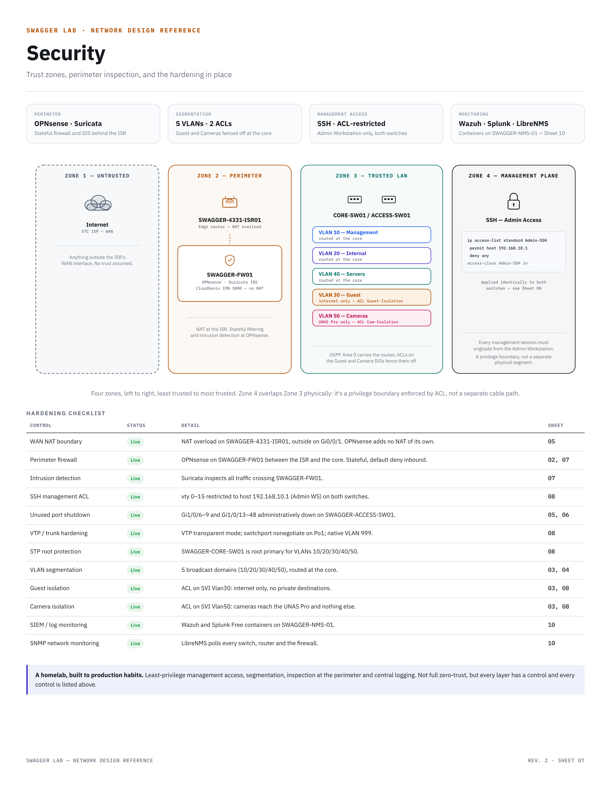
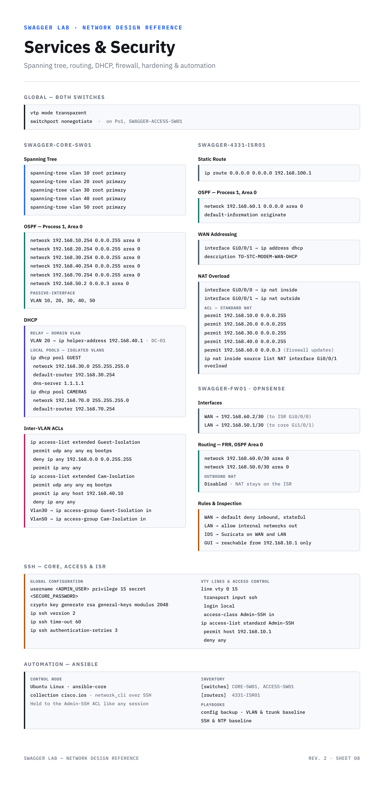
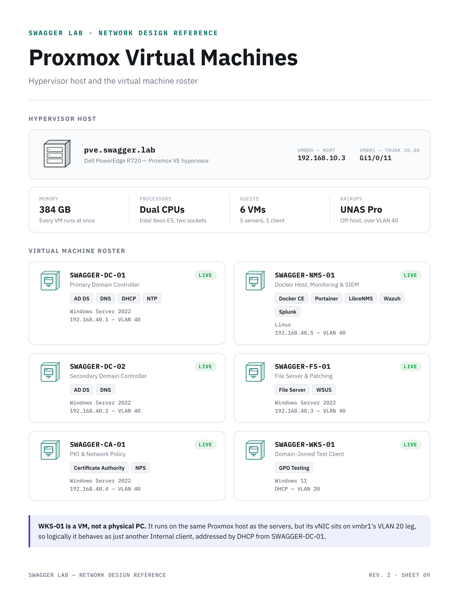
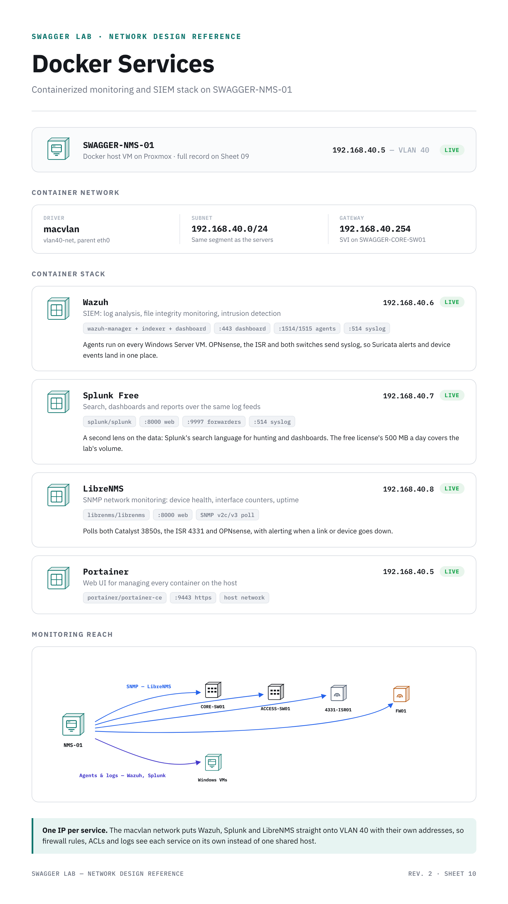

# SWAGGER Lab Build Guide

The design reference for my home data center, one sheet per topic. Click any sheet to open it full size.

**[Download the PDF](SWAGGER-Lab-Build-Guide.pdf)** · [Back to the project](../README.md)

| # | Sheet | What it covers |
|-|-|-|
| 01 | [Project Overview](#01--project-overview) | Hostnames, general configuration, what's built, equipment list |
| 02 | [Network Topology](#02--network-topology) | Every device, every link, and the VLAN each one lives on |
| 03 | [Logical Topology](#03--logical-topology) | Layer 3 view: subnets, gateways and the inter-VLAN policy |
| 04 | [VLAN & IP Addressing](#04--vlan--ip-addressing) | Subnet plan, DHCP scopes, host and transit addresses |
| 05 | [Interfaces & Cabling](#05--interfaces--cabling) | Port-by-port mode, VLAN and what's on the other end |
| 06 | [Rack Elevation](#06--rack-elevation) | Front and rear of the 22U rack, every U and cable run |
| 07 | [Security](#07--security) | Trust zones, perimeter inspection and the hardening checklist |
| 08 | [Services & Security Configuration](#08--services--security-configuration) | STP, OSPF, DHCP, ACLs, SSH, OPNsense and Ansible |
| 09 | [Proxmox Virtual Machines](#09--proxmox-virtual-machines) | Hypervisor host and the VM roster |
| 10 | [Docker Services](#10--docker-services) | Wazuh, Splunk, LibreNMS and Portainer on NMS-01 |

## 01 · Project Overview

Hostnames, general configuration, what's built, and the full equipment list.

## 02 · Network Topology

Every device, every link, and the VLAN each one lives on.

## 03 · Logical Topology

How a packet moves between subnets: the routed path, gateways and the inter-VLAN policy.

## 04 · VLAN & IP Addressing

Subnet plan, assignment type, gateways and every static address.

## 05 · Interfaces & Cabling

Port-by-port mode, VLAN assignment, and what's on the other end.

## 06 · Rack Elevation

The 22U rack, front and rear, with every port numbered.

## 07 · Security

Trust zones, perimeter inspection, and the hardening in place.

## 08 · Services & Security Configuration

The configuration behind the design: spanning tree, routing, DHCP, ACLs, SSH, OPNsense and Ansible.

## 09 · Proxmox Virtual Machines

The hypervisor host and its six virtual machines.

## 10 · Docker Services

The monitoring and SIEM stack on SWAGGER-NMS-01.

---

Configs shown here are sanitized. No passwords or secrets live in this repo.
